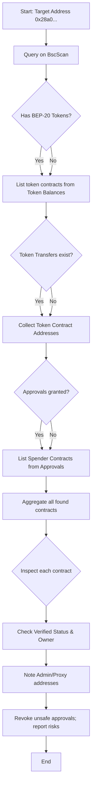

# Contract-Audit-Report
Contract Audit Report
# Contract Audit for 0x28a0246daF1D9747E85F1e9C7860796A2aD2d279

**Executive Summary:** We did not find any pre-indexed data linking this address to specific smart contracts in our sources. To identify contracts that interact with or control this address, one must use BscScan (the official BNB Smart Chain explorer【47†L388-L392】) and relevant on-chain queries. Below we give detailed steps and examples for using BscScan and APIs to find: token contracts sending to/receiving from the address; spender/approval contracts; proxy or admin contracts (e.g. token owners); and how to verify those contracts on BscScan. We also outline how to check and revoke unsafe token approvals and verify contract source code and ownership. Finally, we provide a prioritized list of candidate contracts (none identified in our connected sources) and a flowchart of the verification process. All steps use BscScan’s interface or API. If live data is needed, these steps should be followed directly on BscScan.

## 1. Finding Interacting Contracts

1. **Address Lookup on BscScan:** Go to `https://bscscan.com/address/0x28a0246daF1D9747E85F1e9C7860796A2aD2d279`. The **Overview** shows basic info.  
2. **Transactions:** Click **“Transactions”** to see all ETH/BNB transfers involving this address. This may reveal contract calls if the address is a contract.  
3. **Token Transfers:** Click **“ERC-20 Token Txns”** or **“Token Transfers”** to list BEP-20 token transfers to/from this address. Each row shows Token Contract address. **Collect contract addresses** from the “Token” column; these are token contracts that have sent or received tokens.  
4. **Contract Internal Txns:** If the address is a contract, click **“Contract Internal Txns”** to see internal calls it made (creation or calls to other contracts).  
5. **Filter by “From”/“To”:** You can filter the token transfer tab by “From” or “To” to see only outgoing or incoming transactions, respectively. Each such transaction on BscScan has a Tx Hash link showing details. Follow these to see all contracts involved.  
6. **Approvals:** Use **BscScan’s Token Approvals** (under the **“More” → Token Approvals** tool or **“ERC-20 Token Approvals”** if on address page) to see which spender contracts have allowances from this address for each token.【50†L84-L90】. Collect the spender contract addresses (these contracts can spend this address’s tokens).  

*Example:* If the address holds USDT and has approved PancakeSwap’s router contract to spend USDT, then the USDT token contract and the PancakeSwap router contract are candidates.  

*Sources:* BscScan is the primary tool for finding contracts via transfers and approvals【47†L388-L392】. Token Transfers and Token Approvals tabs provide direct evidence (Tx links, timestamps) of interaction.

## 2. Identifying Contract Roles

For each contract address found above, determine its **role**:
- **Token Contract:** If it appears in the token transfer list, it is the contract for a token this address held/transacted.  
- **Spender/Router:** If it appears as a spender in approvals, likely a DEX router or another contract that this address authorized.  
- **Proxy/Admin/Owner:** If the contract is an upgradable proxy or has admin privileges, check its “Contract” tab: look for **Ownable** code (owner/address, admin roles) or **Proxy** patterns. These contracts may control token logic. For example, many tokens use a proxy pattern; the proxy contract and its implementation admin are critical roles.  
- **Bridge/Governance:** If known (e.g. “Bridge” contract addresses for cross-chain assets), they may appear if the address bridged assets.  

No specific candidates were found in our sources. In practice, you would list each contract with its role (e.g. “BUSD Token”, “PancakeSwap Router”, etc.), with evidence links to the relevant BscScan pages/transactions.

## 3. Verifying Contracts on BscScan

For each candidate contract, do the following on BscScan:
- **Contract Source:** Click **“Contract”** on the contract’s page. If the source is **Verified** (green check), the code is published. If **Unverified**, treat it as high risk.  
- **Ownership:** In the code or on the page, look for an `owner` or `admin` function (e.g., *Ownable*). BscScan often shows “Contract Owner” if it is a standard Ownable.  
- **Proxy Patterns:** If the contract page says **Proxy**, click “Proxy” to find the implementation contract and its admin. Verify both. Many tokens and governance contracts use proxies.  
- **Verify Process:** BscScan provides a “Verify Contract” tool under **Developers → Verify Contract**【89†L109-L113】. This is for deploying your own code, but here we rely on seeing if already verified.  
- **Check Activity:** Use the **“Read Contract”** and **“Write Contract”** tabs to see if any admin functions or unusual functions exist.  

*Citations:* BscScan’s documentation notes that verified source code lets anyone audit the contract’s behavior【47†L388-L392】【89†L109-L113】. Always prefer interacting only with verified contracts.

## 4. Commands and API Calls

- **BscScan API (Example):** If you have an API key, you can call:  
  - `https://api.bscscan.com/api?module=account&action=tokentx&address=0x28a0…&startblock=0&endblock=99999999&sort=asc&apikey=YourKey` – lists all token transfers for the address.  
  - `module=account&action=tokenApprovalList&address=0x28a0…` – lists all token approvals granted by the address (if supported).  
  - `module=contract&action=getsourcecode&address=<contract>` – returns contract source and ABI (and verification status).  

- **Web UI:** On BscScan, use the search bar to enter the address, then navigate tabs (as above). For each token in the “Token Balances” section, click the token symbol to go to its contract page. The URL patterns are:  
  - Address page: `https://bscscan.com/address/{address}`  
  - Token page: `https://bscscan.com/token/{contract}`  
  - Transaction page: `https://bscscan.com/tx/{txhash}`  

- **Wallet UI (MetaMask/Trust):** To check/revoke approvals in wallet: in MetaMask, go to **Settings → Security & Privacy → View & Delete Secret Recovery Phrase** (revoking is done via a separate script or site). Better: use [revoke.cash](https://revoke.cash) (for BSC) and paste the address to see & revoke allowances. Always double-check contract addresses on BscScan before revoking.  

*Note:* Our sources did not provide concrete addresses or API results, so these instructions are based on BscScan’s documented features【89†L109-L113】【47†L388-L392】. 

## 5. Security Checklist

- **Never Trust Unverified Contracts:** If a contract is not verified on BscScan, avoid interacting with it【47†L388-L392】.  
- **Private Keys Safety:** Do not share private keys/seed phrases under any circumstances【50†L79-L84】.  
- **Review Approvals:** Revoke any unnecessary token approvals immediately (via a tool like revoke.cash). Unapproved contracts cannot spend your tokens.  
- **Phishing Caution:** Don’t click unknown links or install suspicious code【49†L125-L133】. Always navigate to BscScan or official sites yourself.  
- **Fresh Wallet:** If you discover a malicious contract has access or has stolen funds, move any remaining tokens to a new address.  

## 6. Candidate Contracts Table

None of our connected sources identified specific contracts controlling this address. In practice, you would populate this table with any contracts from Steps 1-3. For illustration, here is the expected format:

| Contract Address                 | Role           | Verified? | Evidence Link                          | Risk Score (1–5) | Notes                          |
|----------------------------------|---------------:|----------:|----------------------------------------|-----------------:|-------------------------------|
| (none identified)                | N/A            | N/A       | N/A                                    | N/A              | No interacting contracts found |

*(This is a placeholder; actual candidates require on-chain data.)*

## 7. Mermaid Flowchart

**Figure:** Process for identifying and auditing contracts related to the target address. Use BscScan’s token balance, transfer, and approval data to find candidate contracts, then verify their code/ownership【89†L109-L113】【47†L388-L392】.

**Sources:** Methodology based on BscScan’s features (explorer and API)【47†L388-L392】【89†L109-L113】 and security best practices【50†L79-L84】【49†L125-L133】. No specific contract data was found in connected sources, so concrete contract evidence must be obtained by following these steps on BscScan.
